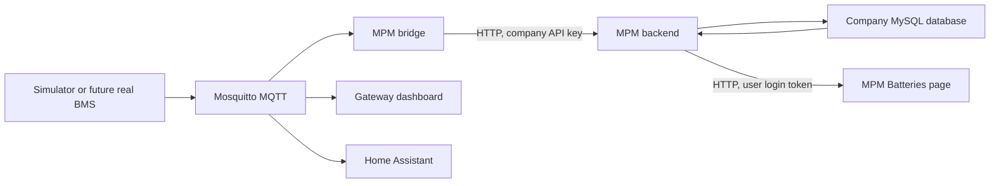

# Team guide

## Where is our work in MicroPowerManager?

The screenshot shows MPM's existing Clusters dashboard.
Our integration is on **Batteries**: [http://localhost:8001/#/batteries](http://localhost:8001/#/batteries).
Scroll the sidebar if Batteries is below the visible menu, or use the direct link.
After a frontend rebuild, use Ctrl+Shift+R if the browser still displays an older page.

For the local demo, use email `demo_company_admin@example.com` and password `123123`.
These are documented demo credentials, not production credentials.
The bridge's demo API key belongs to Demo Company, so its battery records appear in Demo Company's database.
Nexora is a separate company record and currently has no login users.

Open `BAT-001` to see measurements and fault history.
MPM normally receives summaries every 60 seconds, and the battery screens refresh ten seconds after each completed read.
The gateway dashboard shows the faster stream, normally one message per second.
In the normal scenario measurements may barely change; an advancing **Last seen** also proves updates are arriving.

## The different systems

| Part | Main purpose | Address/service |
| --- | --- | --- |
| Mosquitto | Passes MQTT messages between programs | `localhost:1883`, `mosquitto` |
| Simulator | Generates battery measurements without hardware | `simulator` |
| Gateway dashboard | Displays the incoming battery stream | [localhost:3000](http://localhost:3000) |
| MPM bridge | Converts MQTT messages into MPM API requests | `mpm-bridge` |
| MPM backend | Authenticates requests and saves/reads database records | `localhost:8000`, `backend` |
| MPM frontend | Provides the business and Batteries screens | [localhost:8001](http://localhost:8001) |
| MySQL | Stores company and battery data | MPM's `mysql` service |
| Redis | Supports queues and caching | MPM's `redis` service |
| Scheduler and worker | Run MPM scheduled and background tasks | `scheduler`, `worker` |
| Home Assistant | Discovers battery sensors and displays state/history | [localhost:8123](http://localhost:8123) |

Home Assistant is already managed separately on this machine.
Our startup script does not install or start it.
The real BMS adapter and Prospect adapter are planned components, not running implementations.

## How to run both projects

Keep the repositories next to each other:

```text
Project/
├── oseas26-libre-solar-bms-monitoring-gateway/
└── micropowermanager/
```

Install Docker Engine with Docker Compose, Git, and Bash.
Run the commands below from the gateway repository.
Use `sudo bash ...` if your account cannot access Docker.

### Configuration

The current machine is already configured; do not overwrite its environment files.
On a new checkout, create the gateway configuration:

```bash
cp -n .env.example .env
chmod 600 .env
```

Set `MQTT_HOST=mosquitto`, `MPM_BASE_URL=http://host.docker.internal:8000`, and the correct company `MPM_API_KEY` in `.env`.
Keep private keys in ignored environment files, not source code or documentation.
The MPM checkout also needs `.env.backend`, `.env.frontend`, `.env.mysql`, and an initialized company database.
For first-time MPM database setup, follow its installation documentation; our script preserves existing data and disables demo reseeding.

### Start with local changes

```bash
bash scripts/run-systems.sh
```

This builds MPM's four application images, starts MySQL and Redis, waits for MPM, builds/starts the gateway, and runs a 150-second diagnostic watcher.
The watcher exiting does not stop the services.
The PHP builds reuse installed MPM runtime dependencies only if their `composer.lock` exactly matches the checkout.
The frontend is compiled from local source.
The local overlay preserves data volumes, disables startup demo seeding, and gives MySQL an automatic restart policy.
Normal application startup runs migrations without resetting databases.
See [rebuild notes](integrations/mpm/TROUBLESHOOTING.md#build-your-local-mpm-source) if the dependency lockfile changes.

For a different MPM location:

```bash
MPM_DIR=/absolute/path/to/micropowermanager bash scripts/run-systems.sh
```

### Verify incoming updates

```bash
bash scripts/inspect-mpm.sh report
bash scripts/inspect-mpm.sh watch
docker compose logs --since 5m -f mpm-bridge
```

Expect `Forwarded health summary for site-001/BAT-001`, HTTP 200, and an advancing `last_seen_at` for `BAT-001`.
The watcher reads MQTT and the MPM API; it does not publish messages or change battery records.
To inspect raw MQTT:

```bash
docker compose exec -T mosquitto mosquitto_sub -h localhost \
  -t 'libre-solar/#' -v
```

### Stop while keeping data

```bash
docker compose stop
docker compose -f ../micropowermanager/docker-compose.yml stop
```

This preserves Docker volumes and leaves the separately managed Home Assistant container alone.
Do not use `down -v` or `migrate:fresh` on the existing database.

## Which file sends MQTT data to MySQL?

Several files share the work:



| File | Main function |
| --- | --- |
| [`simulator/src/mqtt-publisher.ts`](simulator/src/mqtt-publisher.ts) | Validates and publishes messages and discovery configurations |
| [`integrations/mpm-bridge/src/bridge.ts`](integrations/mpm-bridge/src/bridge.ts) | Subscribes to `libre-solar/+/+/+` and handles battery messages |
| [`integrations/mpm-bridge/src/downsampler.ts`](integrations/mpm-bridge/src/downsampler.ts) | Keeps latest telemetry and maximum temperature during each interval |
| [`integrations/mpm-bridge/src/mapping.ts`](integrations/mpm-bridge/src/mapping.ts) | Converts MQTT fields to MPM health/fault fields |
| [`integrations/mpm-bridge/src/mpm-client.ts`](integrations/mpm-bridge/src/mpm-client.ts) | Sends authenticated HTTP requests to MPM |
| `micropowermanager/src/backend/app/Plugins/LibreSolarBatteryHealth/Http/Controllers/BatteryHealthController.php` | Actually saves and reads records through Laravel's database models |
| `micropowermanager/src/backend/app/Plugins/LibreSolarBatteryHealth/Models/` | Maps health and faults to tenant database tables |
| `micropowermanager/src/backend/database/migrations/tenant/2026_10_09_173000_create_libre_solar_battery_health_tables.php` | Creates `libre_solar_battery_health` and `libre_solar_battery_faults` |
| `micropowermanager/src/frontend/src/modules/LibreSolarBatteryHealth/` | Displays battery list, details, and faults |

The bridge does not connect directly to MySQL.
Its API key selects the company, and MPM selects that company's tenant database.
Health updates replace the current row for a battery; faults append history rows.
MPM does not store every one-second telemetry message through this integration.

| MQTT value | MPM field |
| --- | --- |
| `battery.soc_pct` | `soc` |
| `battery.soh_percent` | `soh` |
| `battery.cycle_count` | `cycle_count` |
| `cells.imbalance_v` | `cell_imbalance_v` |
| Highest `battery.temperature_c` during the interval | `max_temperature_c` |
| `bms.state`, converted to lowercase | `bms_state` |
| `timestamp` | `last_seen_at` |

Bridge writes use `PUT /api/libre-solar/battery-health/health` and `POST /api/libre-solar/battery-health/faults` with a company API key.
The browser reads `GET /api/batteries/health` and `GET /api/batteries/health/{batteryId}` with its login token.
These are HTTP routes, not MQTT topics.

## Project structure in simple words

### Gateway repository

| Folder/file | What it does |
| --- | --- |
| `simulator/` | Runs the fake battery |
| `simulator/src/scenarios/` | Defines normal, charging, discharging, and fault behavior |
| `simulator/tests/` | Tests simulator behavior, schemas, and discovery |
| `schemas/` | Defines valid JSON fields, types, and allowed values |
| `mqtt/` | Configures the Mosquitto broker |
| `dashboard/src/` | Receives MQTT and serves the live dashboard |
| `dashboard/public/` | Holds the dashboard page, styling, and browser code |
| `gateway/` | Reserved for the future Libre Solar/ThingSet hardware adapter |
| `integrations/mpm-bridge/` | Runs the MQTT-to-MPM connection |
| `integrations/mpm/` | Holds MPM local build configuration and troubleshooting |
| `integrations/home-assistant/` | Explains discovery and provides dashboard YAML |
| `integrations/prospect/` | Describes the future history-storage adapter |
| `scripts/` | Starts both projects and checks data flow |
| `docs/` | Explains architecture, deployment, demos, and the MQTT contract |
| `docker-compose.yml` | Defines the four gateway services |
| `.env.example` | Lists settings to copy into the ignored `.env` |
| `team.md` | This team's starting point |

### MicroPowerManager repository

| Folder/file | What it does |
| --- | --- |
| `src/backend/` | Laravel server: API routes, users, databases, and business logic |
| `src/backend/app/Plugins/LibreSolarBatteryHealth/` | Our battery routes, validation, models, and controller |
| `src/backend/database/migrations/tenant/` | Updates tables in each company's database |
| `src/backend/tests/` | Checks backend behavior |
| `src/frontend/` | Business administration web interface |
| `src/frontend/src/modules/LibreSolarBatteryHealth/` | Our battery screens |
| `src/frontend/src/repositories/` | Browser code that calls backend APIs |
| `src/operator-dashboard/` | A separate operator interface |
| `docker/` | Container build recipes and startup scripts |
| `dev/` | Development setup configuration |
| `docs/` | MPM installation and product documentation |
| `collections/` | API request collections for development/testing |
| `k8s/` | Kubernetes deployment configuration |
| `terraform/` | Cloud infrastructure configuration |
| `docker-compose.yml` | Defines MPM services, environment files, ports, and volumes |

## Our MQTT source of truth

Use [docs/MQTT_SPECIFICATION.md](docs/MQTT_SPECIFICATION.md) as the central MQTT reference.
It documents topic names, JSON examples, publishers/subscribers, delivery rules, simulator controls, and Home Assistant discovery.
The linked `schemas/` files are the machine-readable authority for validation.
Change schemas, specification, implementations, and relevant tests together.
Use the same canonical telemetry for MPM, Home Assistant, and Prospect, with consumer-specific mapping in adapters.

For errors and rebuild details, see [MPM troubleshooting](integrations/mpm/TROUBLESHOOTING.md).
